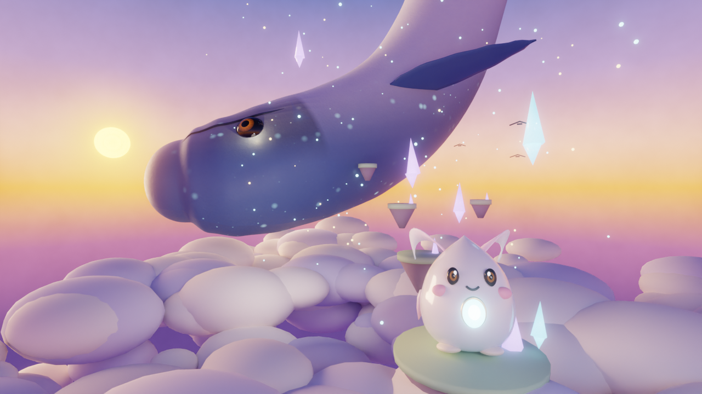

# 涙しずくと空鯨 ― SORAKUJIRA

**海が空へ昇った世界で、眠る巨鯨の体を260メートル登る、縦の冒険。**

雲の海の底に、とぐろを巻いて眠る巨大な空鯨（そらくじら）。
その巨体は成層圏まで届き、冠には月を抱いている。
プレイヤーは鯨が落とした「涙」――雫の精霊 **しずく** となり、
眠る鯨の瞳へ帰るため、走り、跳び、滑空して登りつづける。

Only Up 系の「登る」ゲームでありながら、最優先したのは世界観とビジュアルです。
高度が上がるにつれて、空の色は暁の桃金から真昼のトルコ、夕のマゼンタ、
そして星の瞬く深い藍へと移ろい、鯨の体を彩る足場も七つの世界に姿を変えます。

## 遊び方（プレイ URL）

GitHub Pages を有効化すると、ブラウザだけでここから遊べます（インストール不要）。

**https://uakihir0-bot.github.io/sorakujira-ascent/**

- リポジトリの Settings → Pages → Build and deployment で
  Source を「Deploy from a branch」、Branch を `main` / `(root)` にすると公開されます。
- ローカルで遊ぶ場合は、プロジェクトのフォルダで簡易サーバーを立てて開いてください
  （ES Modules を使うため `file://` 直開きでは動きません）。

```bash
cd sorakujira-ascent
python3 -m http.server 8000
# ブラウザで http://localhost:8000/ を開く
```

## 操作

| 操作 | キー / 入力 |
|---|---|
| 移動 | WASD / 矢印キー |
| 跳ぶ | Space |
| 疾走 | 地上で Shift |
| 空中ダッシュ | 空中で Shift（50m 解放後）。地上で Shift を押したまま跳ぶと、頂点を過ぎたあたりで自動で発動する |
| 二段跳び | 空中でもう一度 Space（25m 解放後） |
| 滑空 | 落下中に Space 長押し（75m 解放後） |
| 最高到達点へ帰還 | T（100m 解放後） |
| 視点 | マウスドラッグ（上下の角度には制限あり） |
| 視点リセット | C / キャンバスをダブルクリック（キャラの背後へ滑らかに戻る） |
| カメラ距離 | ホイール |

## システム

### 高度で目覚める力（解放は落ちても消えない）

高く登るほど、しずくの体と力が育ちます。一度覚えた力は、雲海に落ちて
最初から登り直しになっても **失われません**。それがこの旅の救いです。

| 到達高度 | 解放 | 効果と見た目の変化 |
|---|---|---|
| 25m | 二段跳び | 背に小さな鰭が生える |
| 50m | 風ダッシュ | リボンの鰭が光を帯びる |
| 75m | 滑空 | 鰭が翼へ広がる |
| 100m | 月帰りの大跳躍 | 頭上に光輪が現れる。T で最高チェックポイントへ帰還 |
| 130m | 星屑ブーツ | 跳躍力 +15%（永久）。足もとに星屑が舞う |
| 175m | 風の二重ダッシュ | 空中ダッシュが2回に。鰭の光が紫に変わる |

金の上昇気流（落下時の帰還支援）は一括解放ではなく、登るにつれて
1本ずつ目覚めます。**25m 到達で 0m の柱、55m で 30m の柱、85m で 60m の柱**
が点火し、柱に乗ればその先の高さまで一気に登り返せます。
点火のたびにトーストで知らせます。

### 七つの高度帯

0–30m 珊瑚の尾 ／ 30–65m 鱗の海原 ／ 65–100m 骨帆の夕 ／ 100–135m 星屑の結晶 ／
135–180m 雲の墓地 ／ 180–225m オーロラ海 ／ 225–260m 月冠

足場には、動くもの、ゆっくり回るもの、乗ると崩れてやがて戻るもの、
細い梁など、高度が上がるほど多彩な仕掛けが現れます。

登り道は一本調子の螺旋ではなく、手作りの「移動モチーフ」区間の連なりです
（本道176台＋寄り道12台＝全188台）。ジグザグ跳躍、回転する梁、
12–16m を渡すフェリー（移動足場）、滑空で上昇気流の柱を昇る縦穴区間
（84→95m／161→173m／197→209m）、崩落ガントレット、鯨の背を駆ける区間、
細いバランス梁、そして着地すると大きく打ち上げられる「跳ね雲」
（6.5–7.2m 上の棚へ届かせます）などが入れ替わり現れます。
65m と 225m では登りの向きが反転し、景色の見え方が一変します。
区間の節目には Blender 製の小道具（珊瑚の木、貝殻の尖塔、巨大な肋骨、
結晶の門、遺跡の門、オーロラのリボン、三日月の碑、光の環など14種）が
ランドマークとして立ち、約22%の足場にも小物が散らされています。
チェックポイントは 30／65／101／136／181／225／260m です。

要所には「力の関門」もあります。42m の段差（上昇 3.3m）は二段跳び、
73m の間隔（10.7m）はダッシュ、88m の谷（23.4m）は滑空、
156m の段差（上昇 4.9m）は星屑ブーツがなければ越えられません。
177m の 23.5m の間隔は風の二重ダッシュの見せ場です（滑空でも渡れます）。
全遷移は監査済みで、能力を揃えれば詰みはありません。
覚えた力を使うことが、そのまま前進の条件になります。
迷ったときは、次の未到達の足場を示す光の柱「道しるべ」が道を照らします
（スタート画面で ON/OFF できます）。

### 鯨の記憶（全14個）

道から少し外れた場所に光る「鯨の記憶」を集めると、
鯨とこの世界の物語が詩の断片として少しずつ明かされます。
全14個のうち4個は、本道から分かれて上で合流する4つの寄り道
（腕前で先へ抜けられるショートカット分岐）の先にあります。
寄り道は任意ですが、記憶と近道の見返りがあります。
クリア画面では集めた数が記録されます。

### 落下とリスタート

雲海（y = -9）まで落ちるとスタート地点に戻りますが、
解放した力・最高到達記録・チェックポイントは残ります。
25m から順に目覚める金の上昇気流と、100m で解放される帰還の力で、
前の高さまで気持ちよく駆け上がり直せます。

## 技術メモ

- Three.js r160 を CDN（jsdelivr）から ES Modules + importmap で読み込む単一 HTML ファイル構成です。
- 空は高度で色が変わるカスタムシェーダーのスカイドーム。霧・太陽光・星空・オーロラも高度連動します。
- 任意アセット（Blender 製）: `assets/shizuku.glb`（しずく）、`assets/sorakujira.glb`（空鯨）、
  `assets/crystal.glb`（結晶）、`assets/props.glb`（ランドマーク小道具キット14種）があれば
  自動で読み込み、なければプログラム生成モデルにフォールバックします。
  読み込みがゲーム開始を妨げることはありません。
- すべてのアセットパスは相対パスで、GitHub Pages のサブパス配信でも動作します。
- カメラは、真上・真下を向いて見失わないよう上下角に制限が付き、移動が続くと
  キャラの背後へ緩やかに自動で寄ります（自動アライン）。鯨の体へめり込むこともありません。
- 描画負荷対策: ピクセル比は最大 1.5 に制限。プレイ中の平均 FPS が下がると、
  スプライト雲の削減 → 影オフ → ブルームオフの順に自動で段階的に軽量化します。
  スタート画面では画質を「美麗／軽量」から選べます。

## ファイル

- `index.html` ― ゲーム本体（これひとつで動作）
- `DESIGN.md` ― 世界観・ビジュアル設計書
- `assets/` ― 任意の GLB モデル / キービジュアル
